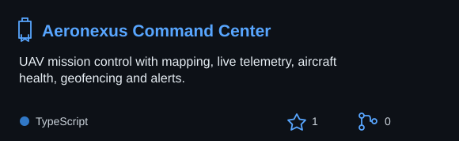
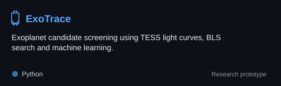
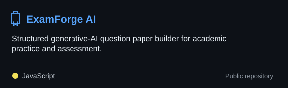
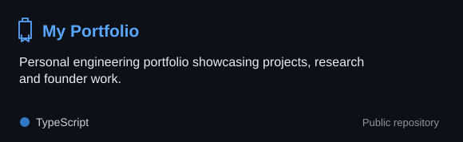

<!-- ============================================================ -->
<!--         SPANDAN SHAH | GITHUB PROFILE | BLUE / DARK           -->
<!--     Adapted from the uploaded ashishpatel26 layout reference  -->
<!-- ============================================================ -->

Spandan Shah
Founder, Aeronexus Aerospace · Computer Engineer · Cybersecurity & Deep-Tech Builder
<!-- DISABLED: remotely generated typing animation (third-party image request).

-->
<!-- ============================================================ -->
<!--                        SOCIAL LINKS                          -->
<!-- ============================================================ -->

<!-- DISABLED: external Shields.io badge image request.

-->
<!-- DISABLED: external Shields.io badge image request.

-->
<!-- DISABLED: external Shields.io badge image request.

-->
<!-- ============================================================ -->
<!--                       BRAND STATEMENT                        -->
<!-- ============================================================ -->

🚀 "I build systems at the intersection of intelligence, security and autonomy — from research prototypes to real-world aerospace applications."

<table width="100%">
<tr>
<td width="60%" valign="top">👋 Who I Am
I'm Spandan Shah, a B.E. Computer Engineering student at Gujarat Technological University, pursuing a Minor in Cybersecurity and working across AI, embedded systems, computer vision, secure communications and UAV technologies.

As the Founder of Aeronexus Aerospace, I am exploring how intelligent sensing, secure peer communication, operational software and autonomous platforms can work together. My projects span embedded cryptographic research, UAV mission control, cyber defense, scientific machine learning and real-time video intelligence.

I prefer end-to-end systems engineering: understand the problem, define boundaries, build a testable prototype, measure what happens and improve it based on evidence.
</td>
<td width="40%" valign="top">⚡ At a Glance
name:       Spandan Shah
role:       Founder / Engineering Builder
venture:    Aeronexus Aerospace
education:  B.E. Computer Engineering, GTU
minor:      Cybersecurity
graduation:  2027 (expected)
focus:      AI · Security · UAVs · Embedded
research:   Secure peer communication
patent:     1 Indian application (pending)
based_in:   Gujarat, India
</td>
</tr>
</table><!-- ============================================================ -->
<!--                  CURRENTLY BUILDING / LEARNING               -->
<!-- ============================================================ -->
🔭 Currently Building & Learning
<table width="100%">
<tr>
<td width="50%" valign="top">🛠️ Building
- 🛰️ Aeronexus Command Center — operator-first UAV mission software
- 🔐 GoblinWisp — identity-bound, reset-safe peer communication prototype
- 🛡️ VigilantEdge — explainable, ML-assisted defensive security architecture
- 🧠 Computer-vision systems — practical sensing, tracking and event analysis
</td>
<td width="50%" valign="top">🌱 Learning & Exploring
- 🚁 UAV integration — flight controllers, telemetry and autonomous systems
- 🔒 Applied cryptography — authentication, replay resistance and protocol state
- 📡 Embedded/RF engineering — constrained devices and wireless resilience
- ⚙️ Reliable AI systems — observability, false-positive control and deployment
</td>
</tr>
</table><!-- ============================================================ -->
<!--                      ENGINEERING TECH STACK                  -->
<!-- ============================================================ -->
🧰 Tech Stack

  <!-- DISABLED external Skill Icons image request:  -->

<!-- Skill Icons provides supported official-style icons; badges name specialist tools that have no supported Skill Icon. -->
<table align="center" width="100%">
<tr>
<td width="26%" valign="middle"><b>💻 Programming & Core</b></td>
<td valign="middle"><!-- DISABLED external Skill Icons image request:  --> Python · Embedded C/C++ · JavaScript · TypeScript · SQL · Linux CLI</td>
</tr>
<tr>
<td valign="middle"><b>🧠 AI, ML & Scientific Computing</b></td>
<td valign="middle"><!-- DISABLED external Skill Icons image request:  --> NumPy · Pandas · ExtraTrees · Classification · Anomaly Detection · Time-Series Analysis · Box Least Squares</td>
</tr>
<tr>
<td valign="middle"><b>👁️ Computer Vision & Video</b></td>
<td valign="middle"><!-- DISABLED external Skill Icons image request:  --> YOLO · DeepSORT · Object Detection & Tracking · OCR · Pose / Gesture Analysis · Real-Time Video Pipelines</td>
</tr>
<tr>
<td valign="middle"><b>🌐 Frontend, APIs & Backend</b></td>
<td valign="middle"><!-- DISABLED external Skill Icons image request:  --> REST APIs · HTTP / Webhooks · Dashboard Interfaces · Backend Services · Gemini API Integration</td>
</tr>
<tr>
<td valign="middle"><b>🗺️ Data & Geospatial Systems</b></td>
<td valign="middle"><!-- DISABLED external Skill Icons image request:  --> SQL · GeoPandas · WebGIS · Satellite Imagery · Mission Maps · Geofencing · Telemetry Data</td>
</tr>
<tr>
<td valign="middle"><b>🔐 Cybersecurity & Cryptography</b></td>
<td valign="middle"><!-- DISABLED external Skill Icons image request:  --> X25519 · HKDF-SHA256 · AES-GCM · Authenticated Key Agreement · Direction-Specific Session State · Replay Protection</td>
</tr>
<tr>
<td valign="middle"><b>📡 Embedded, IoT & Wireless</b></td>
<td valign="middle"><!-- DISABLED external Skill Icons image request:  --> ESP32 · ESP32-CAM · ESP-NOW · NRF24L01 · SPI · UDP Streaming · Serial Diagnostics · Sensor Interfaces</td>
</tr>
<tr>
<td valign="middle"><b>🚁 UAV & Autonomy Software</b></td>
<td valign="middle"><!-- DISABLED external Skill Icons image request:  --> ArduPilot Ecosystem · UAV Telemetry · Mission Planning · Route Visualization · Geofencing · Aircraft Health Monitoring</td>
</tr>
<tr>
<td valign="middle"><b>⚙️ Tooling & Automation</b></td>
<td valign="middle"><!-- DISABLED external Skill Icons image request:  --> n8n · Webhooks · API Testing · GitHub Actions · Serial Debugging · Development Workflows</td>
</tr>
</table>
Specialized engineering domains
<!-- DISABLED: external Shields.io badge image request.

-->
<!-- DISABLED: external Shields.io badge image request.

-->
<!-- DISABLED: external Shields.io badge image request.

-->
<!-- DISABLED: external Shields.io badge image request.

-->
<!-- DISABLED: external Shields.io badge image request.

-->
<!-- DISABLED: external Shields.io badge image request.

-->
<!-- DISABLED: external Shields.io badge image request.

-->
<!-- DISABLED: external Shields.io badge image request.

-->
<!-- ============================================================ -->
<!--                      PATENT & RESEARCH                       -->
<!-- ============================================================ -->
🔬 Patent & Research
Directionally-Isolated Identity-Bound Secure Session Architecture for Infrastructure-Free Peer Communication Systems
Indian Patent Application: 202621025357 · Status: Application filed; patent grant not claimed.

GoblinWisp is the embedded proof-of-concept associated with this research. Its architecture investigates identity-bound authenticated sessions, independent directional cryptographic state, authenticated encryption, replay handling and session invalidation following reset, using ESP32-class devices and ESP-NOW as an experimental transport.

Patent application status is not equivalent to a granted patent. Selected claim and implementation details are intentionally kept at a high level.
<!-- ============================================================ -->
<!--                       FEATURED PROJECTS                      -->
<!-- ============================================================ -->
📌 Featured Projects

Secure Systems · Aerospace Software · AI Research · Computer Vision · Automation

<!-- All 12 projects appear together in a single two-column GitHub-style gallery. -->

<!-- ============================================================ -->
<!--                  GITHUB METRICS & STATS                      -->
<!-- ============================================================ 
## 📊 GitHub Metrics & Stats Dashboard

-->
<!-- ============================================================ -->
<!--                    CONTRIBUTION 3D GRAPH                    -->
<!-- ============================================================ 
### 🧊 My GitHub Contributions in 3D

-->
<!-- A clearly labeled, tracked placeholder appears before the first workflow run.
     GitHub Actions replaces this exact file with a real GitHub-generated 3D calendar. 

Real contribution data is produced by the [3D profile workflow](./.github/workflows/profile-3d.yml). The initial placeholder is replaced after a successful workflow run.

-->
<!-- ============================================================ -->
<!--                    EXPERIENCE & COMMUNITY                    -->
<!-- ============================================================ -->
🎙️ Experience & Community
<table width="100%">
<tr>
<td width="33%" valign="top" align="center">🚀 Founder & Builder
Aeronexus Aerospace 

Deep-tech startup development 

UAV systems & secure communications 

Hardware + software integration
</td>
<td width="33%" valign="top" align="center">🧑‍💻 Team & Leadership
Student Coordinator (2024–2025) 

Tech Lead — Team NIDAR 

Hackathons & collaborative R&D 

Engineering project execution
</td>
<td width="33%" valign="top" align="center">🏅 Highlights
SIH 2024 shortlisted team 

Participation in 5+ hackathons and innovation challenges 

1 Indian patent application 

AI, security & aerospace research
</td>
</tr>
</table>
<!-- DISABLED: external Shields.io badge image request.

-->
<!-- DISABLED: external Shields.io badge image request.

-->
<!-- DISABLED: external Shields.io badge image request.

-->
<!-- ============================================================ -->
<!--                            QUOTE                             -->
<!-- ============================================================ 

-->
<!-- ============================================================ -->
<!--                           FOOTER                             -->
<!-- ============================================================ -->

Thanks for visiting — let's engineer intelligent, secure systems that hold up under real-world constraints.

Explore my public repositories or get in touch through LinkedIn.

