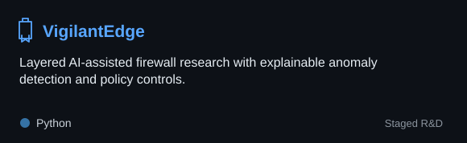
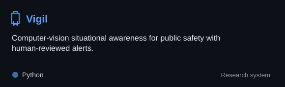
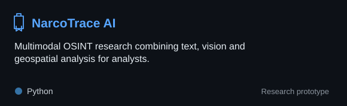
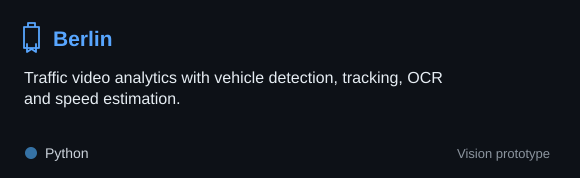
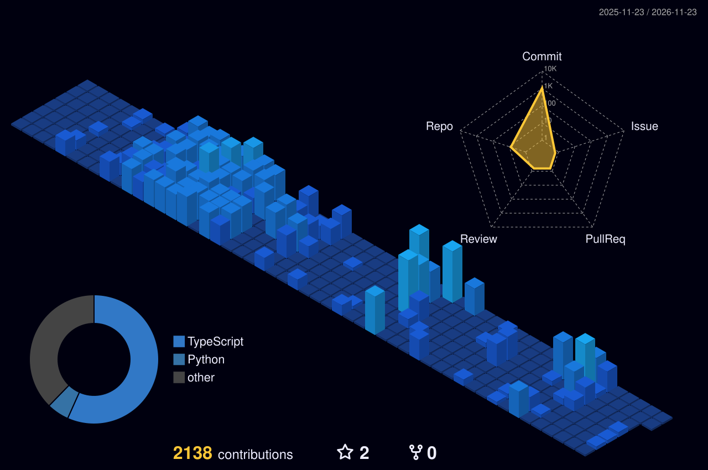

<!-- ============================================================ -->
<!--         SPANDAN SHAH | GITHUB PROFILE | BLUE / DARK           -->
<!--     Adapted from the uploaded ashishpatel26 layout reference  -->
<!-- ============================================================ -->
<div align="center">

# Spandan Shah

#### Founder, Aeronexus Aerospace · Computer Engineer · Cybersecurity & Deep-Tech Builder

<a href="https://git.io/typing-svg">
  
</a>

</div>

<!-- ============================================================ -->
<!--                        SOCIAL LINKS                          -->
<!-- ============================================================ -->
<div align="center">

[](https://www.youtube.com/@Spandanshah)
[](https://www.linkedin.com/in/spandan-shah0312/)
[](mailto:spandanshah10@gmail.com)

</div>

---

<!-- ============================================================ -->
<!--                       BRAND STATEMENT                        -->
<!-- ============================================================ -->
<div align="center">

### 🚀 _"I build systems at the intersection of intelligence, security and autonomy — from research prototypes to real-world aerospace applications."_

</div>

<table width="100%">
<tr>
<td width="60%" valign="top">

## 👋 Who I Am

I'm **Spandan Shah**, a **B.E. Computer Engineering student at Gujarat Technological University**, pursuing a **Minor in Cybersecurity** and working across **AI, embedded systems, computer vision, secure communications and UAV technologies**.

As the **Founder of Aeronexus Aerospace**, I am exploring how intelligent sensing, secure peer communication, operational software and autonomous platforms can work together. My projects span embedded cryptographic research, UAV mission control, cyber defense, scientific machine learning and real-time video intelligence.

I prefer **end-to-end systems engineering**: understand the problem, define boundaries, build a testable prototype, measure what happens and improve it based on evidence.

</td>
<td width="40%" valign="top">

## ⚡ At a Glance

```yaml
name:       Spandan Shah
role:       Founder / Engineering Builder
venture:    Aeronexus Aerospace
education:  B.E. Computer Engineering, GTU
minor:      Cybersecurity
graduation:  2027 (expected)
focus:      AI · Security · UAVs · Embedded
research:   Secure peer communication
patent:     1 Indian application (pending)
based_in:   Gujarat, India
```

</td>
</tr>
</table>

---

<!-- ============================================================ -->
<!--                  CURRENTLY BUILDING / LEARNING               -->
<!-- ============================================================ -->
## 🔭 Currently Building & Learning

<table width="100%">
<tr>
<td width="50%" valign="top">

### 🛠️ Building
- 🛰️ **Aeronexus Command Center** — operator-first UAV mission software
- 🔐 **GoblinWisp** — identity-bound, reset-safe peer communication prototype
- 🛡️ **VigilantEdge** — explainable, ML-assisted defensive security architecture
- 🧠 **Computer-vision systems** — practical sensing, tracking and event analysis

</td>
<td width="50%" valign="top">

### 🌱 Learning & Exploring
- 🚁 **UAV integration** — flight controllers, telemetry and autonomous systems
- 🔒 **Applied cryptography** — authentication, replay resistance and protocol state
- 📡 **Embedded/RF engineering** — constrained devices and wireless resilience
- ⚙️ **Reliable AI systems** — observability, false-positive control and deployment

</td>
</tr>
</table>

---

<!-- ============================================================ -->
<!--                          TECH STACK                          -->
<!-- ============================================================ -->
## 🧰 Tech Stack

<div align="center">
  
  &nbsp;&nbsp;
  
  &nbsp;&nbsp;
  
  &nbsp;&nbsp;
  
</div>

<br/>

<table align="center" width="100%">
<tr>
<td align="right" width="175"><b>💻 Languages & Core</b></td>
<td></td>
</tr>
<tr>
<td align="right"><b>🤖 AI / ML / Vision</b></td>
<td></td>
</tr>
<tr>
<td align="right"><b>🌐 Web / Backend</b></td>
<td></td>
</tr>
<tr>
<td align="right"><b>☁️ Data / Tools</b></td>
<td></td>
</tr>
<tr>
<td align="right"><b>🔌 Embedded / IoT</b></td>
<td></td>
</tr>
</table>

<div align="center">

**🔐 Cybersecurity · Applied Cryptography · UAV Systems · Research**


</div>

---

<!-- ============================================================ -->
<!--                      PATENT & RESEARCH                       -->
<!-- ============================================================ -->
## 🔬 Patent & Research

> **Directionally-Isolated Identity-Bound Secure Session Architecture for Infrastructure-Free Peer Communication Systems**  
> **Indian Patent Application:** `202621025357` · **Status:** Application filed; patent grant not claimed.

**GoblinWisp** is the embedded proof-of-concept associated with this research. Its architecture investigates **identity-bound authenticated sessions**, **independent directional cryptographic state**, **authenticated encryption**, **replay handling** and **session invalidation following reset**, using ESP32-class devices and ESP-NOW as an experimental transport.

<sub>Patent application status is not equivalent to a granted patent. Selected claim and implementation details are intentionally kept at a high level.</sub>

---

<!-- ============================================================ -->
<!--                       FEATURED PROJECTS                      -->
<!-- ============================================================ -->
## 📌 Featured Projects

<div align="center">

**Secure Systems · Aerospace Software · AI Research · Computer Vision**

</div>

<p align="center">

<a href="https://github.com/Spandan-Shah/Aeronexus-Command-Center-Unified-Mission-Control-for-Next-Generation-UAV-Systems"></a>
</p>
<p align="center">


</p>
<p align="center">
<a href="https://github.com/Spandan-Shah/Question-Paper-Generator"></a>
<a href="https://github.com/Spandan-Shah/TinyML---Object-Detection-Using-ESP32-Cam"></a>
</p>

<details>
<summary><b>📂 Explore more engineering projects (6 additional cards)</b></summary>
<br/>

<p align="center">


</p>
<p align="center">


</p>
<p align="center">

<a href="https://github.com/Spandan-Shah/My-Portfolio"></a>
</p>

</details>

<sub>Blue titles use the same GitHub-inspired layout as the reference. Public cards link to the corresponding repositories. Research cards are intentionally not linked to nonexistent or private code. Public star/fork figures are populated from GitHub by the included daily workflow.</sub>

---

<!-- ============================================================ -->
<!--                  GITHUB METRICS & STATS                      -->
<!-- ============================================================ -->
## 📊 GitHub Metrics & Stats Dashboard

<div align="center">


[](https://git.io/streak-stats)


[](https://github.com/Spandan-Shah)

</div>

<!-- ============================================================ -->
<!--                    CONTRIBUTION 3D GRAPH                    -->
<!-- ============================================================ -->
### 🧊 My GitHub Contributions in 3D

<div align="center">

<!-- Generated daily by yoshi389111/github-profile-3d-contrib -->


<sub>Generated automatically from GitHub contribution activity. This image appears after the first successful workflow run.</sub>

</div>

---

<!-- ============================================================ -->
<!--                    EXPERIENCE & COMMUNITY                    -->
<!-- ============================================================ -->
## 🎙️ Experience & Community

<table width="100%">
<tr>
<td width="33%" valign="top" align="center">

### 🚀 Founder & Builder
**Aeronexus Aerospace** <br/>
Deep-tech startup development <br/>
UAV systems & secure communications <br/>
Hardware + software integration

</td>
<td width="33%" valign="top" align="center">

### 🧑‍💻 Team & Leadership
Student Coordinator (2024–2025) <br/>
Tech Lead — Team NIDAR <br/>
Hackathons & collaborative R&D <br/>
Engineering project execution

</td>
<td width="33%" valign="top" align="center">

### 🏅 Highlights
SIH 2024 shortlisted team <br/>
Participation in 8+ hackathons <br/>
1 Indian patent application <br/>
AI, security & aerospace research

</td>
</tr>
</table>

<div align="center">

[](https://www.youtube.com/@Spandanshah)
[](https://www.linkedin.com/in/spandan-shah0312/)
[](mailto:spandanshah10@gmail.com)

</div>

---

<!-- ============================================================ -->
<!--                            QUOTE                             -->
<!-- ============================================================ -->
<div align="center">


</div>

<!-- ============================================================ -->
<!--                           FOOTER                             -->
<!-- ============================================================ -->
<div align="center">

**_Thanks for visiting — let's engineer intelligent, secure systems that hold up under real-world constraints._**

Explore my [public repositories](https://github.com/Spandan-Shah?tab=repositories) or get in touch through [LinkedIn](https://www.linkedin.com/in/spandan-shah0312/).

</div>
