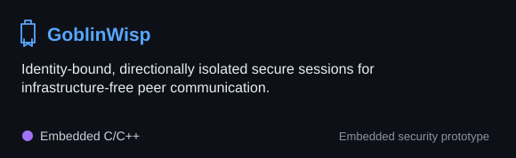
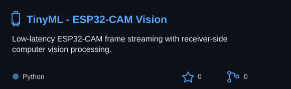
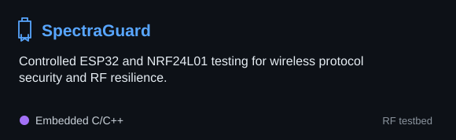
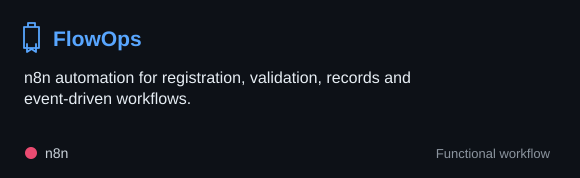

<h1>Spandan Shah</h1>

<b>Founder, Aeronexus Aerospace · Computer Engineer · Cybersecurity &amp; Deep-Tech Builder</b>

<h2>"I build systems at the intersection of intelligence, security and autonomy — from research prototypes to real-world aerospace applications."</h2>

<table width="100%">
<tr>
<td width="60%" valign="top"><h3>Who I Am</h3>

I'm Spandan Shah, a B.E. Computer Engineering student at Gujarat Technological University, pursuing a Minor in Cybersecurity and working across AI, embedded systems, computer vision, secure communications and UAV technologies.

As the Founder of Aeronexus Aerospace, I am exploring how intelligent sensing, secure peer communication, operational software and autonomous platforms can work together. My projects span embedded cryptographic research, UAV mission control, cyber defense, scientific machine learning and real-time video intelligence.

I prefer end-to-end systems engineering: understand the problem, define boundaries, build a testable prototype, measure what happens and improve it based on evidence.

</td>
<td width="40%" valign="top"><h3>At a Glance</h3>
<pre>Name:        Spandan Shah
Role:        Founder / Engineering Builder
Venture:     Aeronexus Aerospace
Education:   B.E. Computer Engineering, GTU
Minor:       Cybersecurity
Graduation:  2027 (expected)
Focus:       AI · Security · UAVs · Embedded
Research:    Secure peer communication
Patent:      1 Indian application (pending)
Based_in:    Gujarat, India</pre>
</td>
</tr>
</table> <h1>Currently Building & Learning</h1>
<table width="100%">
<tr>
<td width="50%" valign="top"><h3>Building</h3>
<ul>
<li>Aeronexus Command Center — operator-first UAV mission software</li>
<li>GoblinWisp — identity-bound, reset-safe peer communication prototype</li>
<li>VigilantEdge — explainable, ML-assisted defensive security architecture</li>
<li>Computer-vision systems — practical sensing, tracking and event analysis</li>
</ul>
</td>
<td width="50%" valign="top"><h3>Learning & Exploring</h3>
<ul>
<li>UAV integration — flight controllers, telemetry and autonomous systems</li>
<li>Applied cryptography — authentication, replay resistance and protocol state</li>
<li>Embedded/RF engineering — constrained devices and wireless resilience</li>
<li>Reliable AI systems — observability, false-positive control and deployment</li>
</ul>
</td>
</tr>
</table><h1>Tech Stack</h1>
<!--

-->

<table align="center" width="100%">
<tr>
<td width="26%" valign="middle"><b>Programming & Core</b></td>
<td valign="middle">

 Python · Embedded C/C++ · JavaScript · TypeScript · SQL · Linux CLI</td>
</tr>
<tr>
<td valign="middle"><b>AI, ML & Scientific Computing</b></td>
<td valign="middle">

 NumPy · Pandas · ExtraTrees · Classification · Anomaly Detection · Time-Series Analysis · Box Least Squares</td>
</tr>
<tr>
<td valign="middle"><b>Computer Vision & Video</b></td>
<td valign="middle">

 YOLO · DeepSORT · Object Detection & Tracking · OCR · Pose / Gesture Analysis · Real-Time Video Pipelines</td>
</tr>
<tr>
<td valign="middle"><b>Frontend, APIs & Backend</b></td>
<td valign="middle">

 REST APIs · HTTP / Webhooks · Dashboard Interfaces · Backend Services · Gemini API Integration</td>
</tr>
<tr>
<td valign="middle"><b>Data & Geospatial Systems</b></td>
<td valign="middle">

 SQL · GeoPandas · WebGIS · Satellite Imagery · Mission Maps · Geofencing · Telemetry Data</td>
</tr>
<tr>
<td valign="middle"><b>Cybersecurity & Cryptography</b></td>
<td valign="middle">

 X25519 · HKDF-SHA256 · AES-GCM · Authenticated Key Agreement · Direction-Specific Session State · Replay Protection</td>
</tr>
<tr>
<td valign="middle"><b>Embedded, IoT & Wireless</b></td>
<td valign="middle">

 
    
 SPI · UDP Streaming · Serial Diagnostics · Sensor Interfaces</td>
</tr>
<tr>
<td valign="middle"><b>UAV & Autonomy Software</b></td>
<td valign="middle">

&nbsp;

 
   
 ArduPilot ecosystem · Flight Controller Configuration · UAV Telemetry · Mission Planning · Route Visualization · Geofencing · Aircraft Health Monitoring</td>
</tr>
<tr>
<td valign="middle"><b>Tooling & Automation</b></td>
<td valign="middle">

 
 
 Webhooks · API Testing · Serial Debugging · Development Workflows</td>
</tr>
</table>

<b><h2>Specialized Engineering Domains  & Work</h2></b>

Patent & Research
Directionally-Isolated Identity-Bound Secure Session Architecture for Infrastructure-Free Peer Communication Systems
Indian Patent Application: 202621025357 · Status: Application filed; patent grant not claimed.

GoblinWisp is the embedded proof-of-concept associated with this research. Its architecture investigates identity-bound authenticated sessions, independent directional cryptographic state, authenticated encryption, replay handling and session invalidation following reset, using ESP32-class devices and ESP-NOW as an experimental transport.

Patent application status is not equivalent to a granted patent. Selected claim and implementation details are intentionally kept at a high level.

<h1>Featured Project And Work</h1>

<!---->

GitHub Metrics & Stats Dashboard

My GitHub Contributions in 3D

## Experience & Community

### Founder & Builder

**Aeronexus Aerospace**  
Founder · Deep-Tech Research & Development

Developing UAV systems and secure communication architectures.
Building integrated hardware–software engineering prototypes.
Exploring AI, embedded systems, cybersecurity and autonomous technologies.

### Leadership & Experience

| Position | Organization / Duration |
| :--- | :--- |
| Founder | Aeronexus Aerospace |
| Student Coordinator | 2024–2025 |
| Technical Lead | Team NIDAR |

Actively involved in collaborative research, technical leadership, product development and engineering project execution.

### Selected Achievements

| Achievement | Details |
| :--- | :--- |
| Smart India Hackathon 2024 | Shortlisted Team |
| Smart India Hackathon 2025 | Participant |
| ISRO Hackathons | 2024 & 2025 |
| Hackathons & Innovation Challenges | 5+ Participations |
| Intellectual Property | 1 Indian Patent Application — Pending |
| Engineering Projects | 12+ Projects |
| Startup Incubation | GTU Ventures |

### Research & Engineering Interests

`Artificial Intelligence` `Cybersecurity` `Applied Cryptography` `Embedded Systems` `Wireless Communication` `Computer Vision` `UAV Systems` `Aerospace Technologies`

---

Thanks for visiting — let's engineer intelligent, secure systems that hold up under real-world constraints.
Explore my public repositories or get in touch through LinkedIn.

